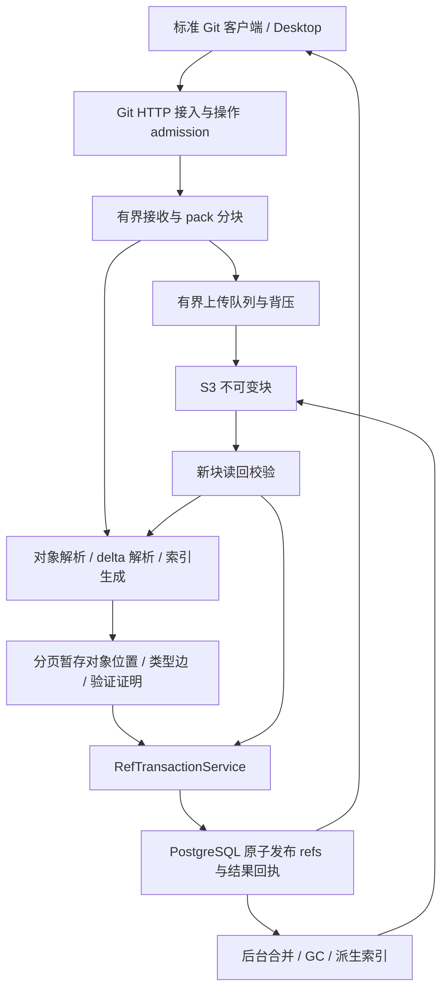

# 可扩展 Git 接收与存储架构

> Native push storage is superseded by the user-approved 2026-10-22
> `adopt-standard-git-pack-storage` first slice: standard packs and bounded stock
> Git replace incoming raw spooling/POB conversion. The remaining POB discussion
> below records the earlier implementation and generic Product write path.

## Third slice approved 2026-10-22

The user approved (1) reusing physical upload verification, (2) consolidating
Desktop probes with an authoritative operation receipt, and (3) set-based SQL
admission/location pages. This keeps the API/worker service topology, PostgreSQL
ref authority and existing POB/S3 layout. It is an internal algorithm and protocol
change, not merely tuning constants. No hosted deployment is authorized.

Readback evidence is request-local and bounded: verified Git identity/type/edges
plus the exact immutable placement, promoted only after real S3 readback, checked
index registration and settlement. Evidence cannot outlive its publication
context; SQL still checks the pin/generation/GC epoch at proof registration and
final publication. Unknown/old objects and callbacks requiring bytes use the
existing durable reader. This evidence is not a published transitive proof: the
closure walker must still check all typed dependencies and aggregate sizes.

Desktop supplies a frozen attempt identifier for initial single-ref pushes. The
server binds it to the authenticated actor and exact ref input, and exposes only
the existing durable operation result through current Git authentication. An
absent result remains uncertain. Stock Git clients remain compatible. Successful
push acknowledgement can finish local bookkeeping without another discovery;
recovery uses the operation result or the existing remote-head reconciliation.

SQL page functions retain existing privileges, payload limits, lock ordering,
pin/epoch checks, identity validation, quota arithmetic and transactional rollback.
Only capacity admission and location pages become set-based in this slice;
dependency-ordered proof registration keeps its existing checked implementation.

状态：已实现首阶段现有 POB 格式下的按字节窗口写入；完整 pack 分块方案尚未启用，
没有证明完整初始化达到 5 秒。已交付范围与证据见 `verification.md`。
日期：2026-10-22。

## 1. 架构决策

保留 PostgreSQL refs + S3 不可变 Git 对象的权威边界。一次 push 是一次发布；
本次 push 的 Git pack 是逻辑传输容器；S3 存储块按压缩字节数划分。
仓库可以包含多个历史 pack，不会在每次 push 时重新打包或上传整个仓库。

采用「逻辑 pack + 固定上限的物理块 + OID 索引 + 短事务发布」。逻辑 pack
可以大于单机内存或缓存，物理块可以跨 Git 对象边界。一个物理块不是独立的
有效 Git pack，不能交给普通 Git 单独解码；StorageBackend 的虚拟文件读取器
负责跨块读取，保持原始逻辑偏移与压缩依赖。

20 MB 的输入自然产生一个尾块；1 GiB 输入产生 16 个 64 MiB 块。没有按
项目名、文件数、commit 数量或每 100 个 Git 对象结束一次远程事务的规则。
对象数仍是解析工作量、安全限额和索引规模的维度。



箭头表示数据或依赖；不是每条箭头都对应一轮 HTTP。后端、数据库与 S3 同地域；
接收 worker 可以横向扩展，本地磁盘仅存本次 incoming 数据及临时索引，不成为
第二个仓库权威，也不下载整个已有仓库。最初实现可保留在现有后端进程内按
职责分模块，只有吞吐隔离需要时再拆独立服务。

## 2. 分块规则与请求模型

初始压测参数，而非已验证的最佳数值：

| 参数 | 起始值 | 作用 |
|---|---:|---|
| 压缩数据块上限 B | 64 MiB | 满块立即封存；EOF 封存不足一块的尾块 |
| 每次 push 存储并发 C | 4 | PUT/GET 共用有界预算，优先排空积压校验 |
| 未完成数据队列 | 最多 4 块 | 占满后停止读入，TCP 背压传递给发送端 |
| 每次 push RAM 预算 | 512 MiB | 包含解析、delta、索引、网络和缓存；达到上限背压/拒绝 |
| 每次 push incoming 临时磁盘缓存 | 2 GiB | 可淘汰已安全落 S3 的 incoming 块；不是整个 repo 镜像 |
| 索引/证明批量写入页 | 至多 4 MiB 编码数据 | 时间到或 EOF 也刷新；最大记录数仅作附加保护 |

RAM、临时磁盘和并发必须由全局 admission 一起预留，不能只限制单次 push。
这些预算不包括任意膨胀；单对象、delta 深度/指令数、总展开字节、对象数、
每租户并发和单次接收总量仍有独立有限上限。超过所选资源 profile 时明确拒绝。

### 存储块大小不等于内存缓冲大小

64 MiB 是一个最终 S3 对象的大小上限，不要求创建同样大的 Python `bytes`。
512 MiB 是包含各种工作区的拟定峰值预算，不是每次初始化固定分配的内存。
「4 路并发」表示最多同时执行 4 个存储请求，不表示把 4 个完整包读入内存。

当前代码的实际路径与内存使用：

| 位置 | 磁盘中的内容 | 内存中的内容 |
|---|---|---|
| `router._spool_git_request_body` | 接收到的请求体 | 当前 `request.stream()` 网络块 |
| `IncomingPack` | 已解析对象及 delta 的临时内容 | 当前对象的解压字节、基对象/差量/还原结果、OID 元数据 |
| `NativeGitRepository.receive.prepare` | 从 incoming spool 读取 | 待写对象字典、当前对象和压缩结果 |
| S3 bundle uploader | 当前无文件流接口 | 编码后的完整 bundle `bytes` 与待上传列表 |
| physical readback | S3 存储 | 当前完整下载结果与预期字节同时存在 |

试验应逐步把数据体传递接口改为「可重新打开/定位的文件段 + 长度 + 摘要」，
而不是 `list[bytes]`。一个 64 MiB 临时文件可通过例如 1 MiB 的 I/O 缓冲持续
上传；读回也流式计算摘要。必须实际验证 SDK 没有把输入重新整体读入内存。
重试重新打开该文件段，不通过永久保留整块 RAM 来实现。旧仓库内容不因此
获得落盘许可；仅本次 incoming 数据和临时索引可使用该磁盘缓存。

近似内存构成为 `连接数 × 每连接缓冲 + 有界解码工作区 + 有界索引页 + SDK/
解释器开销`。1 MiB × 4 只估算应用 I/O 缓冲，绝不是整个 worker 的内存上限。
Git 解压/增量还原仍可能需要完整的单对象工作区；它与压缩块大小分别受限。
验收既测进程内存，也观察系统/容器文件缓存压力，不能只看 Python 分配量。

客户端通过预签名 URL 直传 S3 是另一种接入协议，可减少后端转发带宽，但服务端
仍需读回、解析、验证和提交；标准 Git push 不会自动变成这种协议。本方案当前
保持标准 Git HTTP 接入，不以「直传」为理由跳过这些工作。

分块伪代码：

```text
admit operation with tenant/project budget and current authority
while reading bounded bytes from Git pack stream:
    append bytes to current incoming segment
    parse available headers/entries and stage bounded metadata
    if segment reaches B:
        wait for storage queue credit
        seal sequence + byte length + SHA-256
        enqueue immutable PUT and durable readback
at EOF: seal the tail segment and pack checksum
wait for all byte validation, closure proof and metadata staging
seal attempt; publish once through RefTransactionService
```

64 MiB 块使用普通 PUT，避免对每个块再套一层 multipart。S3 multipart 是
「把多个上传 part 合成为一个 S3 对象」的协议；本设计的 segment 是最终保留的
多个 S3 对象，由 PG manifest 表示一个逻辑 pack。二者不是同一概念。
后续若调整块大小到适合 multipart 的范围，SDK 分片策略另行评估，不能触发
额外的业务级发布事务。32/64/128 MiB 和并发 2/4/8 用相同负载压测选取。

设输入压缩量为 S，B=64 MiB，N=ceil(S/B)。不含薄包基对象、索引、重试和
额外 delta 读取时，主体为 N 次 PUT + N 次读回 GET，总字节约 2S。

| 本次 push 压缩量 | 主体块数 | 主体 PUT + GET | 发布次数 |
|---:|---:|---:|---:|
| 20 MiB | 1 | 2 | 1 |
| 1 GiB | 16 | 32 | 1 |
| 10 GiB | 160 | 320 | 1 |
| 100 GiB | 1,600 | 3,200 | 1 |

这些是分块计算示例，不声明当前服务已接受这些大小。大数据需要更多数据请求；
可扩展性的目标是有限并发、字节线性成本和固定发布阶段，不是任意大小都只有
两次请求。原先「122 -> 2」仅适用于小于一个块且无额外基对象的样本主体。

## 3. 物理表示、索引与 delta

新增版本化的 `segmented-pack-v1` placement，保留现有 loose/POB reader。
建议的逻辑字段（最终表名、DDL 在实现提案评审后确定）：

| 记录 | 关键字段 |
|---|---|
| attempt | project、generation、request key、冻结的 ref edits、状态、owner epoch、过期/回执 |
| pack catalog | pack ID、attempt、格式、总字节、pack checksum、manifest digest、可见状态 |
| segment manifest | pack ID、序号、逻辑 offset、长度、S3 key、SHA-256、验证状态 |
| object placement | project/generation/OID、pack ID、64 位 offset/length、类型、展开大小、delta base |
| staged proof | OID、已验证类型边/聚合、来源字节证明、pin/generation/GC epoch、attempt |

S3 key 包含 project、generation、attempt/owner epoch、segment 序号和内容摘要；
写完不重命名，不为「发布」再 COPY 整个 pack。PG catalog 与 refs 的可见性决定
是否被接受。摘要确保完整性，不作为跨租户授权或公共存在性查询接口。

Manifest 放 PG 分页记录，不把百万条对象清单塞进一个 JSON 字段。对象定位只
记录压缩表示的位置；对象 OID 仍由规范 Git 对象内容确定。OID 重复不重复收取
逻辑对象容量，多个物理表示可以暂时并存；物理 staging/重复表示另受配额约束。

Git 的 OFS_DELTA 使用逻辑 pack 偏移；跨物理块不改变该偏移。REF_DELTA 使用
OID，索引必须支持延迟解析和前向引用。禁止把任意字节片段误当独立 pack，
也禁止对每块独立解压后丢掉原始偏移。

Thin pack 的外部基对象需在获准的旧快照中解析。选择的存储策略是保留收到的
原始 pack 字节，并为它生成必要的、完整非 delta 基对象附加容器；manifest
把它们纳入同一物理保留单元。这避免修改已上传 pack 的头/尾，也避免让新包
永久依赖任意多代旧包。附加容器可使用现有 POB 编码，并按字节有界组织。
它不是新的 Git 传输协议，读取器必须组合原始 pack 与其基对象目录。

旧基对象仅按需读入有界工作内存，不能重建旧仓库或把旧图写入本地磁盘。
附加数据量 A 必须计入存储、传输、容量与验证成本；不能承诺每次只写原始 S。
其新写入物理表示也必须读回。附加完整基对象会增加某些增量 push 的写入量，
这是减少跨 pack 读取依赖的明确取舍；必须用真实增量负载压测，不满足目标时
不能悄悄改为无限跨包依赖。现有单对象/展开/指令限制继续生效；解析器增加
显式的最大 delta 深度与总工作预算。

依赖索引不能全部放 Python 字典。新 incoming 元数据用分页 staging/有界临时
索引保存；已上传数据通过虚拟 pack Range reader 读取。有限 NVMe 窗口不覆盖
整个巨大 pack 时，远距离 delta 可能产生额外 GET，必须计量读取放大并限制
恶意最坏输入。这里不声称任意 Git pack 都只读一次即可解析。

## 4. 数据库控制面与容量

生命周期阶段是 `admit -> receive/stage -> verify/seal -> commit`。每个阶段
有稳定操作标识；对象数增长不会重复完整 admission/权限查询，但阶段内部
可能有索引页、容量信用续领和心跳请求，不能把总数据库成本说成 O(1)。

Desktop 的准备接口聚合创建/恢复初始化项目、准备访问凭据和固定目标；保留
标准 Git discovery。删除重复 ls-remote 检查，最终提交仍重新检查当前权限，
不能把准备阶段授权长期缓存为提交授权。普通 Git 客户端无需调用 Desktop
接口；其 receive 请求在服务端建立同样的 admitted attempt。

索引、对象事实、证明和块清单在 attempt 下分批暂存。建议后端通过受控数据库
连接，以 `COPY FROM STDIN` 向 attempt staging 写入至多 4 MiB 的页，再执行
集合式验证/合并；每页事务及时提交，不长时间持有 ref 锁。不开放客户端直接
COPY canonical 表，也不直接绕过 grant、generation、quota 或 RLS 边界。
如果部署只能使用 PostgREST，则提供同样字节预算的批量 RPC，计数按实际页数
报告；现有硬编码 200 行限制不能靠增加 Python batch 大小绕过。

容量分两类：

- 接收前预留有限 staging 物理字节信用和解析预算。信用覆盖块、索引及附加基
  对象；信用不足先续领再 PUT，无法续领立即背压/拒绝。大操作按较大字节窗口
  续领，窗口可跨多个块，不为每 100 个 OID 重做整套预留。
- 在对象事实可用后分批计算唯一 OID 的 canonical 容量与当前策略约束，并在
  seal/最终提交阶段完成精确结算。新权威可见性建立之前必须满足原有逻辑配额。

这是对容量 API 的明确演进：有界、已付额度的私有 staging 许可与 canonical
发布容量分离。它必须有迁移和等价安全测试，不能把原有容量检查直接删掉。

大型索引的构造、去重、验证、聚合在 seal 前完成。seal 固定 manifest/index
摘要、对象事实和 policy/capacity/GC epoch。最终事务仅验证 seal 和当前权限、
generation、CAS 等条件，原子激活已准备的可见记录、更新 refs/receipt/reflog/
审计/outbox。对象/证明可见性通过已接受的 attempt/catalog 关联控制，不在
最终事务里重新插入或更新全部百万条对象行。

并发发布若改变容量或目录 epoch，使预计算去重结果失效，则重新对受影响事实
seal 或明确冲突；禁止依据过期计数放行。不同分支允许并行接收，只在短提交
阶段竞争必要的项目计数/引用锁；不在整个网络上传期间锁住仓库。

## 5. 持久化、取消与结果恢复

状态：`admitted -> receiving -> verifying -> sealed -> accepted`；也可进入
`rejected` 或 `expired`。客户端响应丢失是观测不确定，不自动改写服务端状态。

所有新物理块保留实际 S3 读回校验。将字节验证凭据绑定到 immutable key/hash、
manifest、generation、pin 和 GC epoch。只有确实来源于已读回字节的对象证明
才可被 seal 复用；本地收到过字节、S3 HEAD 或 PUT 成功不能替代当前契约。
依赖/对象校验结果与物理读回证明组合，避免 closure 阶段无条件再读同一包。

整个存储流水线由一个持久化的 operation-owned I/O 保护范围管理。取消后等待
在途请求结束或进入有期限的恢复状态，不能提前释放保护。需要独立证明 lease
过期、worker 崩溃和迟到 PUT 的处理；不能简单复用已有父 lease 删除子保护。
旧 owner epoch 的写入只能落在其隔离 key 空间，不能提交位置或覆盖新 owner
的数据；GC 在请求最晚完成边界之后重复清理废弃空间，处理迟到孤儿写入。

某块上传失败，重试该块；重试摘要、长度和 epoch 不符必须拒绝。全部数据与
索引 seal 后才可能发布 refs。提交与回执在同一个 PG 事务：响应丢失后按原
request key 查询 `accepted/rejected/pending`，不先创建新项目或新 push。
相同 request key 携带不同的冻结目标/输入身份必须拒绝。

S3 块重试不意味着标准 Git HTTP 支持客户端字节级断点续传。普通 `git push`
连接中断可能仍需重新发送 pack；已完成服务端操作通过回执/refs 恢复。未来
Desktop 若增加可续传接收协议，必须另行定义持久化分片清单、授权和校验，
最终仍进入相同发布入口；本提案不声称已经提供该能力。

长请求通过合法的 Git 进度通道/独立 Desktop 状态读报告接收、验证和发布阶段。
按资源 profile 设置传输空闲、最低持续进度与总处理预算；不能保留统一 300 秒
硬截止后宣称支持任意大仓库，也不能取消所有超时和限额。

## 6. 读取、增量与 GC

读流程：获准的 pinned snapshot -> 批量 OID 定位 -> 逻辑 offset 映射 ->
合并相邻 Range GET -> 受限 delta 解码 -> Git OID 校验 -> 返回对象。
不能为读取一个小文件下载整个 repo/pack，也不能因 S3 有某 OID 就授权读取。
相邻范围合并、请求级解码缓存和 read pin 的授权边界同时成立。

一个 100 GiB 仓库的小 push 按新对象/新边及其必要基对象工作。已有、受 GC
保护的 typed proof 构成验证边界；不在每次 push 中重新扫描历史或列举 S3。
首次导入和缺失/失效证明的修复必须显式计费并受资源预算约束。

多个 push 追加多个逻辑 pack。后台 compaction 根据小包数量、不可达比例和
读放大做有界合并/重编码，不进入正常 push 的等待链。先写并验证新容器，再
原子切换 placement；旧容器在所有读/发布 pin 退出前保留。

GC 必须同时考虑 Git 可达性和物理解码依赖。只要存活对象依赖同容器中的某个
delta base，该基对象和相关块就不能删除。初期整逻辑容器连同基对象附件作为
保留单元；混合存活/死亡对象的空间通过 compaction 回收，而非按块直接删。
这会暂时放大保留空间，但避免损坏增量链。废弃 attempt 有独立 TTL/epoch
回收流程；新格式 GC 上线是开启新格式写入的前置条件。

## 7. 横向扩展与性能合同

按 project 路由到数据库分区/租户资源池；S3 数据没有必须回到某台机器的依赖。
活动 HTTP 流由一个 receiver 拥有，多个 receiver 同时服务多个项目/操作。
worker 数、同时接收数、对象存储并发、数据库连接数与总 RAM/NVMe/网络预算
一起限制，避免 `操作数 × 每操作并发` 无界增长。大导入与小增量采用公平队列，
后台维护使用独立低优先级 I/O 配额。热点项目可迁移独立资源池；PG refs 是该
项目的单写入权威，不做跨节点双主引用写入。

设 S 为新 pack 压缩量、A 为补齐基对象数据、V 为实际对象校验工作量。流水线
理想时间下界近似 `T固定 + max(T客户端生成, S/客户端有效速率,
2(S+A)/共享存储有效吞吐, T校验(V), T索引)`，加尾部 seal/commit；未重叠的
阶段应相加。若上下行链路独立，分别计算各自瓶颈。重试、delta 随机读取和
配额等待均须实测，不用该公式代替端到端验收。

5 秒适用于用户已接受的固定样本全本地测试：411 commits、6,013 objects、约
20 MB pack；服务已启动、用户已登录，每次空目标，从确认初始化到权威发布
和客户端成功，包含 Project/Access/Remote/Upload/Finish。每个计时样本 <5 秒，
并报告分位数和最慢值；本地 Git 1.43–1.90 秒只是下界参照。

大 push 的目标是吞吐随带宽/CPU提高、内存不随总量增长、请求按字节块/索引页
增长，而非任意 repo 都 <5 秒。分别测试小增量、20 MB、1 GiB、10 GiB（仅在
相应资源 profile 开放后），高重复/低重复内容、海量小对象、跨块/前向 delta、
并发大导入与小 push。比较一次与十次数据量的时间、峰值 RAM、NVMe、请求数、
读写放大，识别超线性退化。真实同地域 PG/S3 与客户端网络单独验收。

指标至少记录每阶段开始/结束、每 RPC 开始/结束、排队、字节数、对象数、PUT/
GET/Range 次数、数据库页数、重试、quota 续领、proof 命中、delta 读放大、最终
事务时间和响应恢复。S3 写入计时与 lease 释放计时分开，修正现有日志无法拆分
的混合时间窗口。

## 8. 交付顺序与取舍

1. 先合并 Desktop 准备与后端控制调用，建立真实 PG/S3 请求预算和完整计时。
2. 在现有 POB 格式中实现按字节组织、有界并发与批量 staging，先消除 100 个
   对象一次串行事务；这不等于完成 pack 格式优化。
3. 增加 segmented-pack reader、manifest、delta/base 处理、验证证明和 GC；
   双读验证通过后才开启新格式写入，旧 loose/POB 继续可读。
4. 开启有界流式接收与新的资源 profile；当前 128 MiB pack、256 MiB graph、
   100,000 objects 等硬限制必须逐项替换，不能只调 HTTP body 大小。
5. 用固定样本验收 <5 秒，再验收大输入吞吐、并发公平和失败恢复；随后按独立
   发布流程部署。搜索/预览等派生工作继续在后台。

数据库采用 Expand 后启用 feature flag。关闭新写入可回退，但一旦产生新格式
数据，旧 reader/GC 不支持该格式的二进制不能直接回滚；须保留新 reader 或先
执行已验证的数据转换。这里不创建/应用任何迁移、不改生产数据。

没有选整仓库单文件反复覆盖：小修改将导致全量重传且阻碍 GC。
没有选每对象一个 S3 请求：小对象的请求延迟与控制面开销过大。
没有选直接把所有对象塞进一个 SQL 请求：索引、锁、消息大小和内存无法扩展。
没有选本地磁盘成功即返回、异步补 S3：这会改变当前权威与持久化承诺。
本设计相对 Gitaly 的成本是网络 Range/delta 读放大和维护复杂度；用压测证据
判断是否值得，而不是假设包格式本身保证 GitLab 的延迟。

## 9. 证据与参考

- 本地固定样本测量与日志审计：
  `/var/folders/nh/xvn2nk3x1vl84c1jzdv2zh880000gn/T/puppyone-push-baseline-_08x97_y/`。
  此路径为本机临时证据；CI 必须将重新生成的脱敏结果归档到测试产物。
- 当前权威：[Version Engine](../../../../docs/architecture/01-version-engine.md)、
  [Native Git transport](../../../../docs/architecture/17-native-git-object-transport.md)。
- [Git pack format](https://git-scm.com/docs/pack-format)：OID/offset 与 delta 表示。
- [Git receive configuration](https://git-scm.com/docs/git-config#Documentation/git-config.txt-receiveunpackLimit)：保留较大 incoming pack。
- [GitLab Gitaly](https://docs.gitlab.com/administration/gitaly/)：本地存储架构。
- [GitLab housekeeping](https://docs.gitlab.com/administration/housekeeping/)：后台仓库维护。
- [S3 performance](https://docs.aws.amazon.com/AmazonS3/latest/userguide/optimizing-performance-guidelines.html)：同地域、并发与 Range。
- [PostgreSQL COPY](https://www.postgresql.org/docs/current/sql-copy.html)：流式批量传输。

GitLab 的事实是 pack/index、本地存储和独立维护。64 MiB 分块、PG manifest、
配额信用、附加基对象容器与上述预算均是本项目的拟议设计，不归因于 GitLab。

## 10. 当前 POB 路径的元数据优化切片（2026-10-22）

本轮实施已获用户授权的控制面合并，保持既有容量模型。当前接收器在上传前
已经完成有限 incoming pack 解析，可以直接使用已知 OID/type/body-size 清单，
精确预留整次上传容量；所有物理窗口共用新生成的 io_id。编码流必须逐项匹配
该清单，遗漏、多出或身份不符都不能结算。保留现有 100,000-object 等入口预算，
这里没有提前实现未知长度输入的物理 staging 信用，也没有提高大仓库准入上限。

新增 storage/prepared_ingestion.py 管理操作生命周期，metadata_pages.py 管理
4 MiB / 16,384 行元数据页；S3 backend 仍负责物理格式、读回和受围栏保护的 RPC。
真实读回成功后的位置可跨上传窗口合并。只有生产者、所有 worker 和位置 RPC
全部结束才能结算一次；异常/取消保留已有持久化 I/O 围栏，不提前退还容量。

容量、位置、证明及 seal 使用新增 bounded-page RPC。一个网络请求在 PostgreSQL
内部依序调用既有 200 行检查函数，保留完整授权、身份、配额和 epoch 检查；后半
页失败回滚整页。证明保留依赖顺序。这里优化网络往返，不宣称消除内部逐行处理。
发布前仍按 closure 的真实事实核对容量，只将原有多个往返合并；不信任客户端大小
估算，不省略 closure、proof、policy 或最终 ref CAS。

只新增 Expand migration，保留旧函数及存储格式。需先按独立发布流程应用迁移，
再启动新版 writer；本轮不改运行中的远程 PG/S3。独立的 staging credit、耐久读回
证明复用、原始 delta pack 和客户端准备合并仍按前述设计另行交付。
